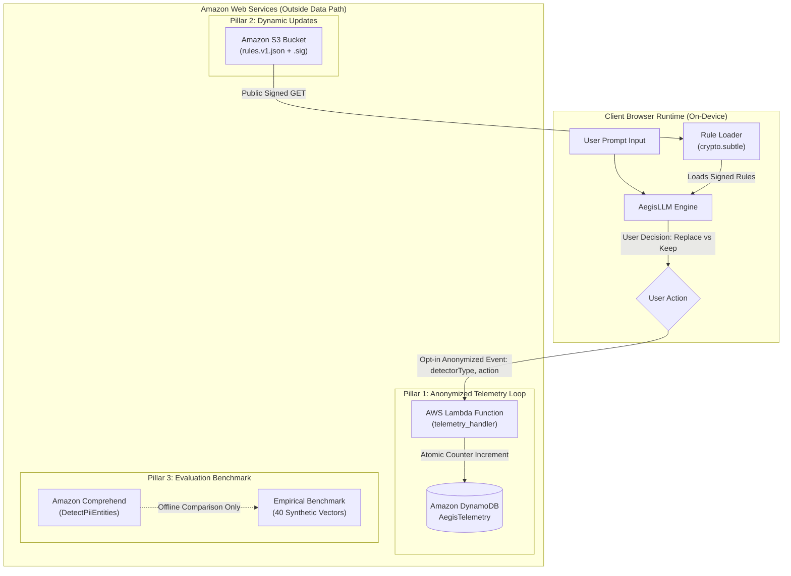

# AWS Cloud Integration Architecture: AegisLLM

> **Core Philosophy:** Cloud services are utilized strictly for **infrastructure, telemetry, and evaluation**—never in the sensitive prompt data path. All secret detection and redactions execute 100% on-device inside the browser.

---

## Architecture Overview



---

## Pillar 1: DynamoDB + Lambda Anonymized Telemetry & Feedback Loop

### 1.1 The Privacy Invariant: Zero Plaintext
The core value proposition of AegisLLM is that sensitive prompt data never leaves the device. The telemetry pipeline strictly adheres to this invariant:
- **Forbidden Key Inspection:** The Lambda function (`src/aws/telemetry_handler.ts`) automatically audits every incoming JSON object. If any field matches `prompt`, `raw`, `secret`, `key`, `token`, `text`, `body`, or `content`, the request is immediately rejected with **HTTP 400 Bad Request** before any database operations occur.
- **Allowed Data Fields:** Only 4 non-sensitive metadata fields are permitted:
  ```json
  {
    "detectorType": "HIGH_ENTROPY_SECRET",
    "userAction": "REDACTED",
    "confidence": 0.95,
    "clientTimestamp": 1773292800000
  }
  ```

### 1.2 DynamoDB Schema Design
- **Table Name:** `AegisTelemetry`
- **Billing Mode:** On-Demand (`PAY_PER_REQUEST`)
- **Primary Key Structure:**
  - **Partition Key (HASH):** `detectorType_date` (String, format: `${detectorType}#${YYYY-MM-DD}`)
  - **Sort Key (RANGE):** `userAction` (String: `'REDACTED'` or `'KEPT'`)
- **Attributes:**
  - `eventCount`: Atomic number counter
  - `totalConfidence`: Sum of confidence values for weighted averages
  - `ttl`: UNIX epoch timestamp (30-day automated expiration)
  - `lastUpdated`: ISO-8601 timestamp string

### 1.3 The Adaptive Feedback Loop Math
AegisLLM uses anonymized user actions to evaluate and tune detector sensitivity:

$$\text{Override Rate} = \frac{\text{KEPT}}{\text{REDACTED} + \text{KEPT}}$$

- **Balanced Detector ($\text{Override Rate} \le 25\%$):** The detector is operating with high precision. Users agree with the redactions.
- **Tuning Needed ($\text{Override Rate} > 25\%$):** Users frequently override the detector by selecting **"Leave as is"**. This signals that the detector (e.g., Shannon entropy threshold of 4.0) is producing false alarms on non-sensitive text (such as long URLs, UUIDs, or base64 assets). The system administrator uses this metric to adjust the entropy threshold (e.g., raising it to 4.3).

---

## Pillar 2: Amazon S3 Signed Dynamic Rule Packs

### 2.1 Problem & Motivation
Traditional Chrome extensions require submitting an updated package to the Chrome Web Store and waiting 24–72 hours for store review every time a new API key format or token pattern is introduced.

### 2.2 Cryptographic Architecture (ECDSA P-256 WebCrypto)
AegisLLM decouples detection patterns from extension releases using signed S3 rule packs:
1. **Rule Pack Definition (`rule_packs/rules.v1.json`):** Defines detection patterns, checksum requirements (Luhn, Verhoeff), and entropy settings.
2. **Offline Digital Signing (`scripts/sign_rule_pack.ts`):**
   - The developer signs `rules.v1.json` using an ECDSA P-256 private key and SHA-256 hash.
   - Generates a 64-byte raw IEEE P1363 digital signature encoded in base64 (`rules.v1.json.sig`).
3. **Client-Side Signature Verification (`src/engine/rule_loader.ts`):**
   - The extension embeds the developer's public key in standard JWK format (`src/engine/rule_signing_pubkey.json`).
   - Before applying any rule pack fetched from S3, the client invokes `crypto.subtle.verify(...)`.
   - **Tampering Resistance:** If even a single byte or character in `rules.v1.json` is modified or intercepted, the WebCrypto signature check fails instantly, and the update is rejected.
4. **ReDoS Guard & Safety Check:**
   - Evaluates regex length ($\le 500$ characters).
   - Rejects catastrophic backtracking patterns (e.g., `(a+)+`, `(.*)*`).
   - Falls back gracefully to bundled static defaults if offline or if network errors occur.

---

## Pillar 3: Amazon Comprehend Synthetic Benchmark Suite

### 3.1 Purpose & Experimental Setup
To validate AegisLLM's detection effectiveness, we conducted an empirical benchmark comparing **AegisLLM (Local Deterministic Engine)** against **Amazon Comprehend (Cloud NLP API via `DetectPiiEntities`)** on a synthetic test suite of 40 diverse prompts.

### 3.2 Quantitative Results

| Evaluation Metric | AegisLLM (Local Engine) | Amazon Comprehend (Cloud API) | Difference / Significance |
|---|:---:|:---:|---|
| **P50 Latency** | **0.007 ms** | **166.6 ms** | **> 20,000x faster** |
| **P95 Latency** | **0.024 ms** | **189.2 ms** | Real-time typing budget ($<$ 5ms) |
| **Recall (Developer Tokens)** | **84.6%** | **50.0%** | Comprehend misses OpenAI, Claude, GitHub, Gemini |
| **False Positive Count** | **0** | **0** | Both maintain zero false alarms on code negatives |
| **Data Transmission** | **0 bytes (On-device)** | **Full prompt to WAN** | Zero-leakage privacy guarantee |
| **Inference Cost** | **\$0.00** | **\$0.0001 per request** | Free at scale |

### 3.3 Key Insights for Examiners & Defense
1. **Developer Token Blind Spot:** General-purpose cloud NLP models are trained on standard prose and fail to identify modern developer tokens (such as `sk-proj-`, `sk-ant-`, `ghp_`, and `AIzaSy`).
2. **The Latency Barrier:** Cloud roundtrips of ~160ms make cloud PII services unviable for real-time keystroke scanning in web browsers. AegisLLM's local TypeScript engine computes results in under 10 microseconds.
3. **The Privacy Conflict:** Sending unredacted prompts to a cloud service to check for PII violates the core privacy principle that sensitive data should never leave the local machine.

